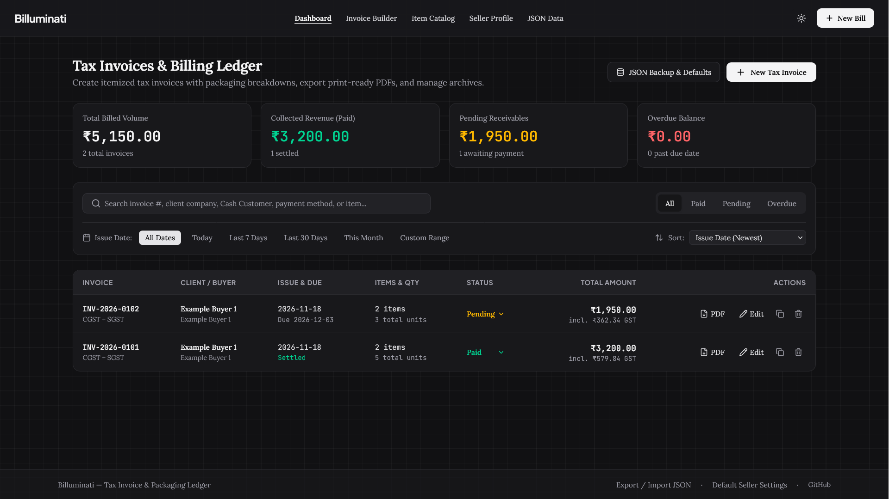
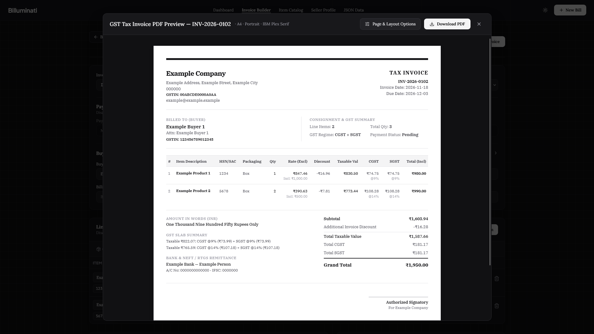

# Billuminati — GST Tax Invoice & Billing Studio

<p align="center">
  
</p>

**Billuminati** is a fast, uncluttered, offline-capable Indian GST Tax Invoice and billing studio built with React, TypeScript, Tailwind CSS, and `jsPDF`. It starts with a clean slate—zero pre-populated sample bills or dummy profiles—and runs 100% in your browser using `localStorage` with portable JSON backups.

**[Live Demo](https://billuminati.ai.studio)** · **[GitHub Repository](https://github.com/DoctorLestrange/Billuminati)**


<br>


---

## Key Features

### 1. Clean Start & Local-First Privacy
- **Zero Sample Clutter**: Starts with an empty invoice ledger, blank seller/bank profile, and empty item catalog so you can configure your own business details immediately.
- **100% Browser-Local Storage**: All data stays in your browser's `localStorage` and can be exported or imported as portable `.json` files at any time.

### 2. Indian GST Compliance & Dynamic Bidirectional Pricing
- **GST Regimes**: Supports **CGST + SGST (Intra-State)**, **IGST (Inter-State)**, and **GST Exempt / Nil Rated (0%)**.
- **Bidirectional Rate Entry**: Type into any pricing field on a line item—**Rate (Excl. ₹)**, **Rate (Incl. ₹)**, **Taxable Value (₹)**, or **Total (Incl. ₹)**—and all related fields back-calculate automatically.
- **Tax-Compliant Final-Value Discounts**: Enter line-item or additional invoice discounts in Rupees (`₹`) on the final payable amount; Billuminati automatically scales down the pre-tax **Taxable Value** and recalculates GST so `Taxable Value + GST = Final Payable Amount`.

### 3. Cash Customer & Payment Settlement Tracking
- **Cash Customer Mode**: Issue counter/cash invoices immediately without entering buyer company name, GSTIN, or address details.
- **Payment Status & Settlement Tracking**: Choose between **Pending**, **Paid**, and **Overdue**; marking an invoice **Paid** automatically clears the due date and enables optional tracking for payment method (`Direct Bank Transfer`, `UPI`, `Cash`, `Cheque`, or `Others`), payment date, and transaction reference details.

### 4. Industrial Packaging & Quick-Add Item Catalog
- **Packaging Breakdown**: Supports **25+ industrial & retail units** (`Box`, `Carton`, `Drum`, `Roll`, `Bucket`, `Tin`, `Bottle`, `Bag`, `Pallet`, etc.).
- **Saved Item Catalog (Tax-Inclusive)**: Save frequently billed items by entering their **tax-inclusive unit price (`₹`)** and **GST rate (`%`)** for one-click insertion in the Invoice Editor.

### 5. Print-Ready PDF Export (`IBM Plex Serif`) & Automatic Square Seller Logo
- **1-to-1 Preview & Export Fidelity**: Both the live PDF preview sheet and downloaded PDF files use embedded **IBM Plex Serif** (Regular & Bold) with automatic multi-line wrapping for long item names.
- **Automatic Square Seller Logo Processing**: Upload any company logo—non-square images are automatically padded to a `1:1` square canvas without stretching and downscaled to `512×512px`.
- **Customizable Page Layout**: Configure paper size (`A4`, `Letter`, `Legal`), orientation (`Portrait`, `Landscape`), margin density, accent color, and toggleable invoice sections.

### 6. Portable JSON Export & Import
- **Zero Lock-In**: Export all invoices, seller defaults, bank remittance details, square logo data, default terms & conditions, and catalog items to a single `.json` file, and restore in **Merge** or **Replace** mode.

---

## Getting Started

### Prerequisites
- **Node.js** `v18+` (recommended `v20+`)
- **npm** `v9+`

### Installation & Local Development

1. **Clone the repository**:
   ```bash
   git clone https://github.com/DoctorLestrange/Billuminati.git
   cd Billuminati
   ```

2. **Install dependencies**:
   ```bash
   npm install
   ```

3. **Start the development server**:
   ```bash
   npm run dev
   ```
   Open [http://localhost:3000](http://localhost:3000) in your browser.

---

## Scripts

| Command | Description |
| :--- | :--- |
| `npm run dev` | Starts the Vite development server on port `3000` |
| `npm run build` | Builds the production bundle into `dist/` |
| `npm run preview` | Previews the production build locally |
| `npm run lint` | Runs TypeScript type-checking (`tsc --noEmit`) |
| `npx tsx --test src/utils/billing.test.ts` | Runs the unit test suite for GST math, discounts, logo squaring, and JSON backups |

---

## Usage Guide

1. **Configure Your Business Profile & Logo**: Open **Seller Profile** in the top navigation bar, upload your **Seller Brand Logo**, enter your company name, GSTIN, address, bank/IFSC details, and optional default Terms & Conditions, and click **Save Default Profile**.
2. **Manage Saved Catalog Items**: Open **Item Catalog**, enter the item name, HSN/SAC code, packaging unit, **Unit Price (Incl. Tax ₹)**, and **Tax (%)**, and click **Add Preset**.
3. **Create a GST Tax Invoice**: Click **New Bill**, select the **Payment Status** and **GST Supply Type**, fill in buyer details (or check **Cash Customer**), and add line items or rupee discounts.
4. **Preview & Export PDF**: Click **Preview & Export PDF** to inspect the formatted invoice in **IBM Plex Serif**, customize layout options if needed, and click **Download PDF**.
5. **Backup & Restore Data**: Click **JSON Data** to export a `.json` backup of your workspace or import an existing `.json` file.

---

## ⚠️ Legal Disclaimer, Assumption of Risk & Limitation of Liability

**Billuminati** ([https://github.com/DoctorLestrange/Billuminati](https://github.com/DoctorLestrange/Billuminati)) is an open-source, AI-generated application provided strictly **"AS IS"**. Use it at your own risk and verify all tax calculations and invoices independently; the developer is in no way responsible or liable for anything arising from its use.

<details>
<summary><strong>Read Full Legal Disclaimer, Assumption of Risk & Limitation of Liability (Click to expand)</strong></summary>
<br>

**PLEASE READ CAREFULLY BEFORE USING, MODIFYING, OR DISTRIBUTING THIS SOFTWARE:**

1. **Open-Source AI-Generated Software**: **Billuminati** (source code available at [https://github.com/DoctorLestrange/Billuminati](https://github.com/DoctorLestrange/Billuminati)) is an **open-source, AI-generated application** released strictly for general informational, educational, and utility purposes.
2. **Beta Application**: This application is incomplete and in testing, hence, prone to bugs, errors and inconsistencies.
3. **Use Strictly at Your Own Risk**: Any and all actions, invoices, tax calculations, filings, documents, financial records, or business transactions created, exported, printed, or managed using this application are **100% the user's own doing and sole responsibility**. You must exercise extreme caution, due diligence, and independent verification before relying on any output generated by this software.
4. **No Tax, Legal, Accounting, or Financial Advice**: Nothing in this software or repository constitutes professional tax, legal, accounting, chartered accountancy, or statutory GST compliance advice. Tax laws, GST rules, HSN/SAC rates, invoicing mandates, e-invoicing regulations, and rounding rules are subject to change and interpretation. You are solely responsible for verifying that every invoice, tax rate, discount calculation, and document complies with applicable local, state, and national laws and regulations (including Indian GST laws).
5. **Provided "AS IS" Without Warranties**: This software is provided **"AS IS"** and **"AS AVAILABLE"**, without warranty or representation of any kind, express or implied, including but not limited to the warranties of merchantability, fitness for a particular purpose, accuracy, completeness, reliability, regulatory compliance, data persistence, or non-infringement. Because all data is stored locally in the user's browser (`localStorage`), the developer does not host, back up, or guarantee the retention or security of your data.
6. **Complete Waiver & Limitation of Liability**: Under **no circumstances** and under **no legal theory** (whether in contract, tort, negligence, strict liability, statute, or otherwise) shall the developer, repository owner (`DoctorLestrange`), contributors, or maintainers be held responsible or liable in any way whatsoever for any direct, indirect, incidental, special, exemplary, punitive, or consequential damages, financial losses, tax penalties, statutory fines, audit liabilities, calculation discrepancies, lost profits, data loss, business interruption, or legal disputes arising out of or in connection with the use, misuse, or inability to use this software—even if advised of the possibility of such damages. **By using this software, you unconditionally agree to assume all risks and hold the developer harmless from any and all claims.**

</details>

---

## License

Licensed under the Apache License 2.0.
